<p align="center">
  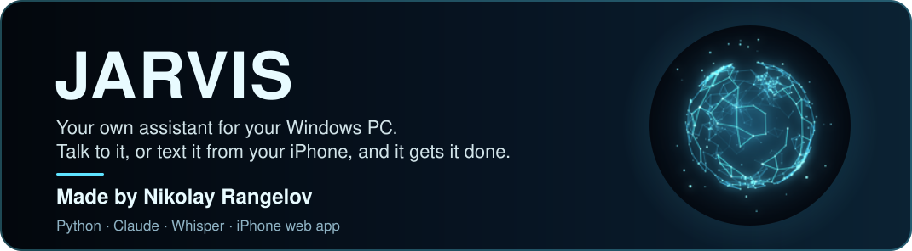
</p>

<p align="center">
  <a href="https://github.com/Izu83" title="Nikolay Rangelov (Izu83)"></a>
</p>

<p align="center">
  
  
  
  
  
  
</p>

<p align="center">
  Say <b>“Hey Jarvis, open Spotify and Discord and put them on my left monitor”</b>, or type it on your iPhone from
  anywhere, and it happens. Jarvis lives on your Windows PC, listens for his name, answers out loud,
  and you can chat with him from your phone, the desktop app or Siri.
</p>

<p align="center">
  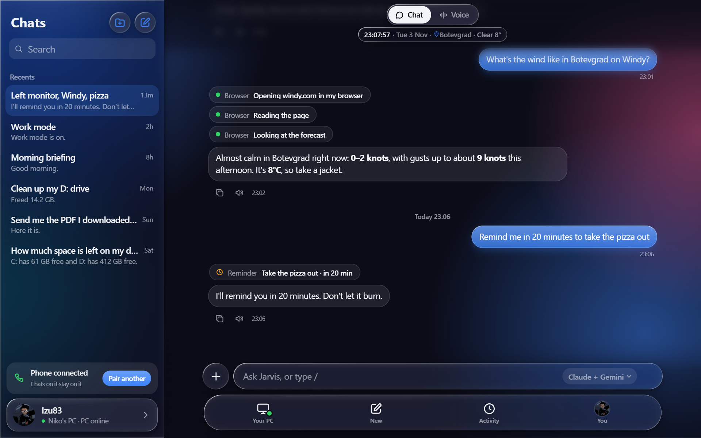
</p>

<table>
  <tr>
    <td align="center" width="33%">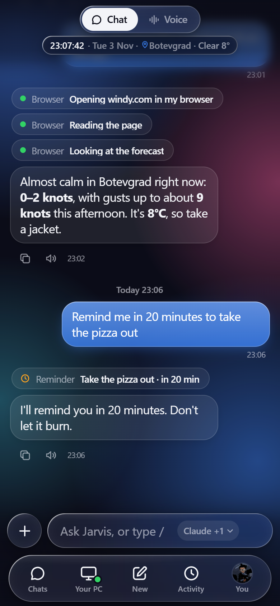<br><sub><b>Chat</b>: every step he takes, as it happens</sub></td>
    <td align="center" width="33%">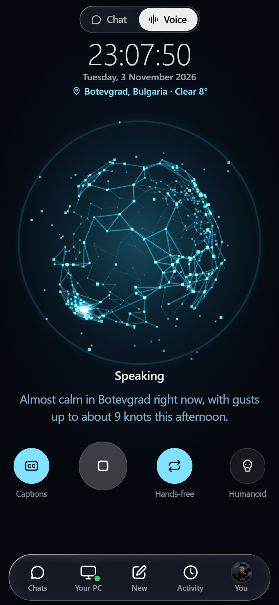<br><sub><b>Voice mode</b>: just talk to him</sub></td>
    <td align="center" width="33%">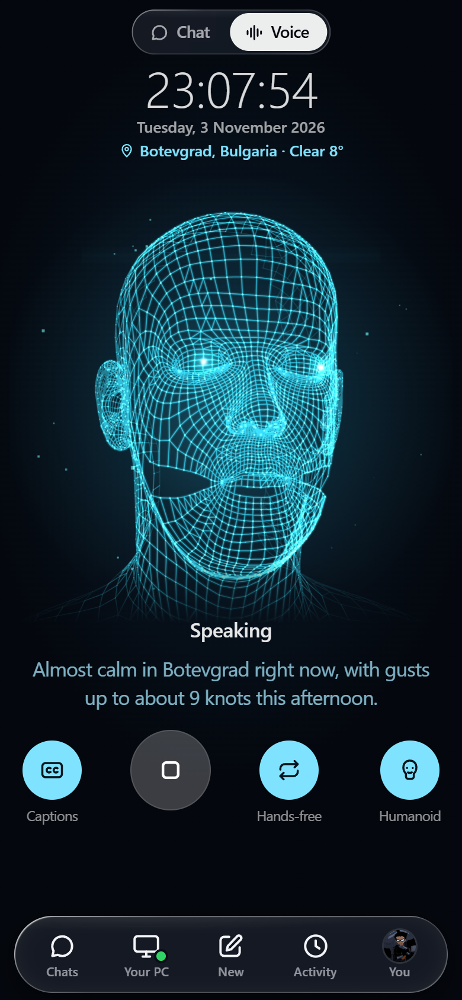<br><sub><b>Humanoid</b>: a face that talks back</sub></td>
  </tr>
</table>

<p align="center">
  <a href="#what-it-does">What it does</a> ·
  <a href="#how-it-works">How it works</a> ·
  <a href="#getting-started">Getting started</a> ·
  <a href="#talking-to-jarvis">Talking</a> ·
  <a href="#things-you-can-say">Things to say</a> ·
  <a href="#modes">Modes</a> ·
  <a href="#on-your-iphone">iPhone</a> ·
  <a href="#voice-mode">Voice mode</a> ·
  <a href="#your-pc-at-a-glance">Your PC</a> ·
  <a href="#the-desktop-app">Desktop app</a> ·
  <a href="#the-models">Models</a> ·
  <a href="#jarvis-messages-you">Messages</a> ·
  <a href="#privacy-and-safety">Privacy</a> ·
  <a href="#settings">Settings</a> ·
  <a href="#troubleshooting">Troubleshooting</a> ·
  <a href="GUIDE.md"><b>Full guide</b></a>
</p>

<h2><a name="what-it-does"></a></h2>

| | |
|---|---|
| 🎙️ **Listens for “Hey Jarvis”** | On your PC's microphone, in English or Bulgarian, and answers in a natural voice. Say “stop” or “wait” to cut him off. |
| 🖥️ **Runs your PC** | Opens apps, folders and websites, moves windows between your monitors, controls music and volume, locks, sleeps or shuts down the PC. |
| 🗂️ **Modes** | Say “work mode” and every app opens in its place on every monitor, in about a second. |
| 📱 **Chat from your iPhone** | The same commands by text or voice, from anywhere, with live pictures of your screens and a remote control for your PC. |
| 💻 **A desktop app** | Your chats down the side and a model picker, like a normal chat app, on the PC itself. |
| 🔵 **Voice mode** | A glowing orb, or a 3D head, that listens, thinks and talks back. Hands-free, like a phone call. |
| 🗣️ **Siri** | “Hey Siri, Ask Jarvis” works too, and so does the Share button in any app. |
| 🌐 **Website jobs, out of sight** | Checking Windy, sending an Instagram message, filling in a form: done in his own hidden browser, so your screen and mouse stay yours. |
| 🏫 **Your school diary** | Grades, homework, the timetable and absences from Shkolo, in Bulgarian or English, and a message when a new grade comes in. |
| 🔔 **Messages you first** | A morning briefing, an evening recap, reminders, scheduled tasks, and a heads-up when an important email arrives. |
| 📄 **Finds your files** | “Send me the PDF I downloaded yesterday” lands on your phone in a second. |
| 🧠 **Remembers** | What you talked about, and the facts you tell him (“remember that Ana's email is…”). |
| 🔒 **Asks before risky things** | Deleting, running commands, shutting down: with Face ID on the phone, or Windows Hello on the PC. |

<h2><a name="how-it-works"></a></h2>

<p align="center">
  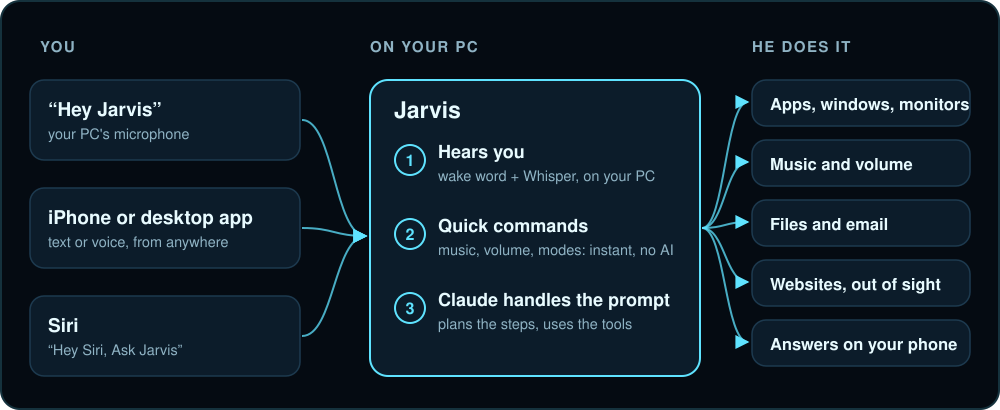
</p>

1. **Hearing you.** A small wake-word model listens for “Hey Jarvis” all the time, on your PC, without sending anything anywhere. When it hears it, a pop-up appears in the corner of your main monitor and [Whisper](https://github.com/SYSTRAN/faster-whisper) writes down what you say, also on your PC (on the graphics card when there is one, so it takes under a second).
2. **Quick things first.** Simple commands like “next song”, “volume up”, “lock the PC” or “work mode” are understood right on the PC by a small parser, with no AI at all, so they're instant and free. Anything with more than one part goes on to step 3, so nothing gets half done.
3. **Claude handles the prompts.** Everything else goes to Claude, which plans the steps and uses Jarvis's tools to carry them out: open this, move that window, read the screen, search the files, check a website, send a message. Each step shows up live as a small pill in the chat, and the answer is spoken out loud.
4. **Your phone connects from anywhere** through an encrypted tunnel, not just on your home Wi-Fi (see [Privacy and safety](#privacy-and-safety)).

<h2><a name="getting-started"></a></h2>

**What you need**

| | |
|---|---|
| **PC** | Windows 11 with a microphone and speakers |
| **Python** | [Python 3.13](https://www.python.org/downloads/) |
| **Claude** | A [Claude](https://claude.ai) plan (Pro or Max) and [Claude Code](https://claude.com/claude-code) installed |
| **Phone** *(optional)* | An iPhone with Safari, for the phone app and Siri |
| **Graphics card** *(optional)* | An NVIDIA card makes speech recognition much faster, and is needed for good Bulgarian |
| **Node.js + Chrome** *(optional)* | For website jobs in the hidden browser |

**1. Download and install**

```bash
git clone https://github.com/Izu83/Jarvis.git
cd Jarvis
py -3.13 -m venv .venv
.venv\Scripts\pip install -r requirements.txt
```

**2. Log in to Claude once.** Open a terminal, run `claude`, type `/login`, finish in the browser, then `/exit`. Jarvis uses that login, so there's no API key to pay for.

**3. Start Jarvis**

```bash
run.bat
```

Nothing opens: Jarvis sits in the taskbar tray (under the **^** arrow). **Click** the icon to open the desktop app; **right-click** it to pick a microphone, pair your phone, log in to a site for him, restart him or quit.

The first start downloads the speech models (a few hundred MB, plus about 1.6 GB if you want Bulgarian). After that, say **“Hey Jarvis”** (or press **Ctrl+Alt+J**), say what you want, and pause.

**4. Optional extras**

| Command | What it does |
|---|---|
| `run.bat --startup` | Start Jarvis automatically when you log in to Windows (`--startup-off` to stop) |
| `.venv\Scripts\python -m jarvis.desktop --install` | Put a **Jarvis** shortcut on the Desktop and in the Start menu |
| `run.bat --pair` | Show the QR code that connects your phone (the tray menu has it too) |
| `run.bat --keys` | Add the free Gemini and OpenRouter keys, or ChatGPT / Grok keys (see [The models](#the-models)) |
| `run.bat --email` | Connect your email so Jarvis can check, read and send it |
| `npm install --prefix .brain/browser-mcp @playwright/mcp@0.0.83` | The hidden browser for website jobs |
| `run.bat --console` | Run with the log in a window, to see what's going on |
| `run.bat --text` | Type commands in the console instead of talking (handy for testing) |

<h2><a name="talking-to-jarvis"></a></h2>

- **Wake him up** with “Hey Jarvis”, or press **Ctrl+Alt+J**. Then say what you want and pause; he notices when you've finished.
- **The pop-up** in the top-right corner of your main monitor shows what he heard as you speak, then each step while he works, then his answer.
- **Cut him off**: while he talks, say **“stop”** (or “стоп”) and he goes quiet, or **“wait”** (“чакай”) and he goes quiet and listens. “Jarvis, open Chrome” stops him and does that straight away.
- **His voice** is one of Microsoft's natural voices: Ryan (British, like the films) by default, or Thomas, Andrew, Sonia or Aria. Bulgarian answers get a Bulgarian voice.
- **English, Bulgarian or both**: pick it in Settings › Language you speak. In “both”, he works out which one you're speaking for every command.
- **Where you are**: the phone tells him its location with each command, so “the weather here” and “how far is…” mean where you really are.

<h2><a name="things-you-can-say"></a></h2>

| | You say | What happens |
|---|---|---|
| **Apps and windows** | “Open Spotify, Claude and File Explorer and put them on my left monitor” | Opens all three and tiles them on that monitor |
| | “Maximize Chrome on the main monitor” | Moves and resizes it |
| | “Open Claude's Jarvis project” | Opens the app, then clicks through it to the project |
| **Music** | “Pause the music”, “next song”, “turn it up a bit” | Controls whatever is playing, in any app |
| **Files** | “Send me the PDF I downloaded yesterday” | Finds it and sends it to your phone |
| | “What's using all the space on my D: drive?” | Shows the biggest folders and what's safe to clean |
| **Websites** | “What's the wind like in Botevgrad on Windy?” | Checks the site in his hidden browser and tells you |
| | “Send Ana a message on Instagram that I'm on my way” | Sends it, without touching your screen |
| **School** | “Какви оценки имам?” / “What are my grades?” | Your grades this term from Shkolo, the average and the latest one |
| | “Какви часове имам утре?” / “What classes do I have tomorrow?” | Tomorrow's lessons, times and rooms (holidays too) |
| | “Имам ли домашно?” / “Колко отсъствия имам?” | Recent homework, or your absences and which are unexcused |
| **Email** | “Check my email” | Unread mail, sorted into important and not important |
| | “Reply to Anna and say I'll be there” | Writes the reply and sends it |
| **Time** | “Remind me in 20 minutes to take the pizza out” | A reminder on your phone and PC |
| | “Every morning at 8, check my email and tell me what matters” | A task that runs every day and messages you |
| | “Tell me when the download is finished” | Watches it and lets you know |
| **Your PC** | “How much space is left on my disks?” | Answers from live PC stats |
| | “Take a nap” | Locks the PC and turns the screens off, but keeps it reachable from your phone |
| | “I'm leaving” | Away mode: if someone touches the mouse or keyboard, you get a message and a webcam photo |
| **Memory** | “Remember that Boris's email is boris@work.com” | Saved for good, and used next time you mention Boris |
| **Bulgarian** | “Кой си ти?” | Answers in Bulgarian, with a Bulgarian voice |

<h2><a name="modes"></a></h2>

A mode is a saved layout you start with one phrase. Modes run instantly and don't use AI at all.

<p align="center">
  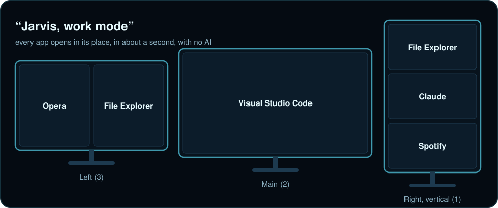
</p>

Make or change modes just by asking: *“Jarvis, make a gaming mode with Discord on the vertical monitor and Steam full screen on the main one”*, or *“in work mode, put Chrome instead of Opera”*. They're saved in `modes.json`, and each one becomes a `/` command in the app (`/work`, `/game`, …).

<h2><a name="on-your-iphone"></a></h2>

The phone app is a web app on GitHub Pages ([izu83.github.io/Jarvis](https://izu83.github.io/Jarvis/)), so there's no App Store and nothing to pay for.

<table>
  <tr>
    <td align="center" width="200"><br><sub>On your Home Screen</sub></td>
    <td>
      <b>Set it up once</b><br>
      1. On the PC, right-click the Jarvis tray icon › <b>Pair your phone (QR code)…</b><br>
      2. Scan the code with your iPhone camera and open the link in <b>Safari</b>.<br>
      3. Tap <b>Share › Add to Home Screen</b>. Jarvis now opens like a normal app.<br><br>
      <b>Siri:</b> in the app, open <b>Settings › Siri &amp; Share</b> and follow the steps once. Then say <i>“Hey Siri, Ask Jarvis”</i>, or pick <b>Ask Jarvis</b> under any app's Share button.<br><br>
      <b>Your laptop too:</b> set Jarvis up on it the same way, then in the app tap <b>Settings › Your computers › Add a Computer</b> and paste the laptop's pairing link. Switch between them at the top of Control Center (the computer tab). Each keeps its own chats.
    </td>
  </tr>
</table>

<table>
  <tr>
    <td align="center" width="33%">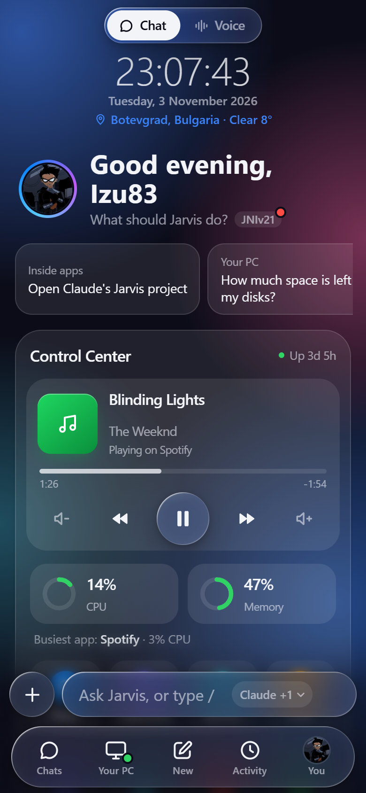<br><sub><b>A new chat</b>: the time and weather where your PC is, ideas, and the Control Center</sub></td>
    <td align="center" width="33%"><br><sub><b>Step pills</b>: what he's doing, live, saved in the chat</sub></td>
    <td align="center" width="33%">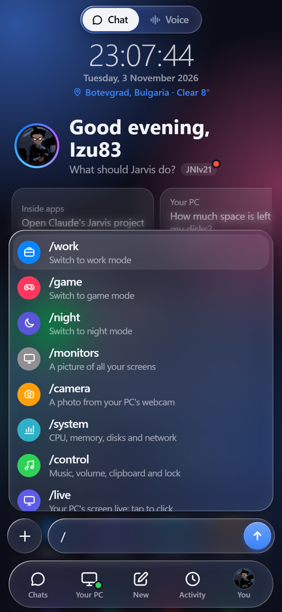<br><sub><b>Type <code>/</code></b> for every shortcut and mode</sub></td>
  </tr>
</table>

- **Chats and groups**, each with its own memory, plus search. Press and hold a chat to rename, move or delete it.
- **Stop button**: while he works, the send button becomes ■. Press and hold your own message to send it again or edit it.
- **Nothing gets lost**: if the app was closed while he worked, the answer arrives as a notification and is waiting in the chat.
- **Activity**: every command from the phone or the PC microphone, with its steps and the answer.

**Slash commands**

| Command | What it does | Command | What it does |
|---|---|---|---|
| `/work`, `/game`, … | Start one of your modes | `/live` | Your PC's screen live: tap to click, pinch to zoom |
| `/monitors` | A picture of all your screens | `/camera` | A photo from your PC's webcam |
| `/system` | CPU, GPU, memory, disks, network | `/control` | Music, volume, clipboard and lock |
| `/find` | Find a file and send it here | `/cleandisk` | Free up space on a disk |
| `/briefing` | Weather, calendar, email and your PC | `/recap` | Your day, and tomorrow |
| `/away` | A photo if someone uses your PC | `/nap`, `/wake` | Screens off, but still reachable |
| `/lock` | Lock your PC | `/stop` | Stop what Jarvis is doing |
| `/voice` | Voice mode | `/health` | Is everything working? |

<h2><a name="voice-mode"></a></h2>

<table>
  <tr>
    <td align="center" width="50%"></td>
    <td align="center" width="50%"></td>
  </tr>
</table>

Switch to **Voice** at the top of the app and just talk. The orb changes with each moment: cyan and slowly breathing while it waits, green with a heartbeat while it listens, violet and spinning while Jarvis works, and pulsing with every word he says.

- **Hands-free** (on by default): after each answer he listens again, like a phone call. Say “bye” or stay quiet to stop.
- **Humanoid**: the button next to Hands-free swaps the orb for a glowing wireframe head that looks around, blinks, faces you while you talk and moves its lips with his voice.
- **Your words appear live** as you speak, and his answer starts playing while the rest is still being made.
- **Say “Hey Jarvis” to the PC** and the orb on your phone lights up too.
- **Straight into Voice mode**: Settings › Voice mode gives you a link you can put on the iPhone's Action Button or Back Tap.

<h2><a name="your-pc-at-a-glance"></a></h2>

<table>
  <tr>
    <td align="center" width="50%">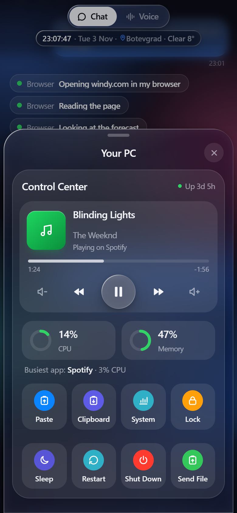<br><sub><b>Control Center</b>: now playing, CPU and memory, and one-tap buttons</sub></td>
    <td align="center" width="50%">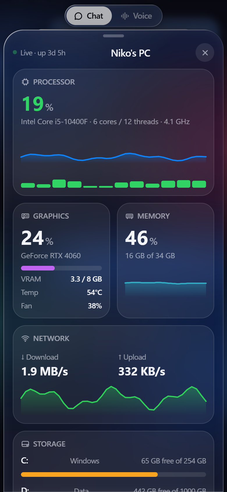<br><sub><b>System</b>: live CPU, graphics card, memory, network and disks</sub></td>
  </tr>
</table>

The Control Center's buttons go straight to the PC without any AI, so they're instant and free: play and skip music, change the volume, send your phone's clipboard to the PC (or get the PC's), lock, sleep, restart or shut down, and send a file. **Nap** locks the PC and turns the screens off but keeps it reachable, so you can wake it from your phone later.

<h2><a name="the-desktop-app"></a></h2>

The same app as on your phone, in a window on the PC, with your chats down the side. Open it by clicking the tray icon, from the **Jarvis** shortcut, or from Windows search.

- **No pairing needed**: it talks to Jarvis on the same PC directly, never through the internet.
- **Your phone**: the card at the bottom of the chats shows whether your phone is connected, and **Pair** shows the QR code for a new one.
- **Closing the window doesn't stop Jarvis**: he stays in the tray for your phone and “Hey Jarvis”.
- **Approvals** in the desktop app ask for your Windows PIN, face or password (Windows Hello) instead of Face ID.

<h2><a name="the-models"></a></h2>

<table>
  <tr>
    <td width="300" align="center">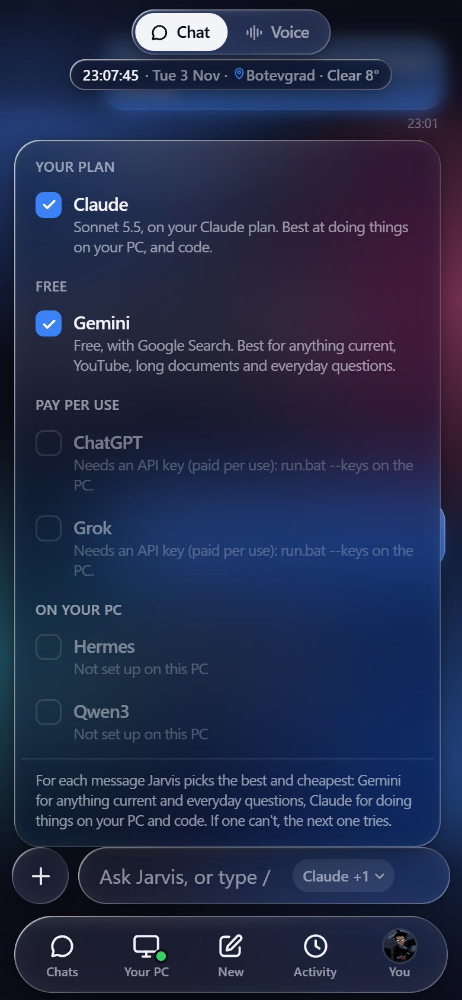</td>
    <td>
      Claude handles the prompts. Tap the model name in the message box and tick any others Jarvis may use too. For each message he picks the best ticked one for the job that costs the least, and if one fails or hits its limit, the next one answers.<br><br>
      <b>Claude</b>: your Claude plan. Doing things on the PC, code, reading the screen.<br><br>
      <b>Gemini</b>: free, with a key from <a href="https://aistudio.google.com/apikey">Google AI Studio</a>. Everyday questions, and anything current, with Google Search. Always the newest Flash model your key can use, and the next one down when that's busy or out of today's free allowance.<br><br>
      <b>Free models</b>: free, with a key from <a href="https://openrouter.ai/keys">OpenRouter</a>. DeepSeek whenever it's free there, otherwise the strongest free model (like NVIDIA's Nemotron 3 Ultra). About 50 questions a day.<br><br>
      <b>ChatGPT, Grok</b>: pay per use, never past the monthly budget you set. Grok for X / Twitter.<br><br>
      <b>Hermes, Qwen3</b>: free on your graphics card with <a href="https://ollama.com">Ollama</a>. Simple commands when you're offline or out of Claude.
    </td>
  </tr>
</table>

| The job | Who goes first |
|---|---|
| Doing things on the PC, many steps | Claude, then Gemini, the free models, local, ChatGPT |
| Code | Claude, then ChatGPT, Gemini, the free models |
| The screen, photos you send | Claude, then Gemini, ChatGPT |
| Anything current (news, prices, search) | Gemini, then Claude, Grok, ChatGPT, the free models |
| YouTube, long documents | Gemini, then Claude, the free models |
| X / Twitter | Grok, then Gemini, Claude |
| Everyday questions and chat | Gemini, then the free models, Claude, local, ChatGPT, Grok |

<h2><a name="jarvis-messages-you"></a></h2>

| | |
|---|---|
| ☀️ **Morning briefing** | Every morning (08:30 by default): the weather, today's calendar (your iPhone's or Google's), reminders, unread email and how the PC is doing. `/briefing` any time. |
| 🌙 **Evening recap** | At 21:30: what he did for you today, your time in apps, tomorrow's first events and weather. `/recap` any time. |
| ⏰ **Reminders and watches** | “Remind me at 6”, “tell me when the render is finished”. |
| 📅 **Scheduled tasks** | “Every weekday at 18:00, tell me the weather for tomorrow.” |
| ✉️ **Important email** | A heads-up when an important email arrives (Settings › Memory › Messages you on his own). |
| 🩺 **Self-check** | If something he needs breaks (the microphone, his Claude login, your email login, disk space), he tells you once, with the fix. |

Between 23:00 and 08:00 his messages still arrive, but quietly, without a notification.

<h2><a name="privacy-and-safety"></a></h2>

<p align="center">
  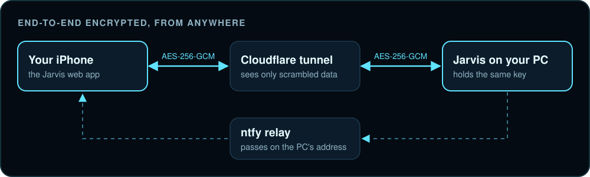
</p>

- **Your voice stays on your PC.** The wake word and speech recognition both run locally.
- **Phone and PC talk end-to-end encrypted** (AES-256-GCM). The tunnel and the relay in between only ever see scrambled data. Old or replayed messages are ignored.
- **Your keys live in `.env`** on your PC, which is never uploaded. The code and the phone page contain no secrets.
- **Risky actions ask first**: deleting files, running commands, shutting down. With Face ID for permissions on, the phone's Allow button needs your face; on the PC, Windows Hello or your Windows password. Messages and emails go out without asking, and you can turn the questions off completely in Settings › Security.
- **Hard limits stay**: Windows, Program Files and your main folders can never be deleted. Normal deletes go to the Recycle Bin.
- **The hidden browser has its own profile**, separate from your browsers. It's only logged in where you log it in yourself; Jarvis never types your passwords.
- **Keep your pairing link private.** It's the key to your PC. If you lose your phone, delete `JARVIS_TOPIC` and `JARVIS_KEY` from `.env` and run `run.bat --pair`.

<h2><a name="settings"></a></h2>

Most settings are in the app (**You › Settings**). Everything is also in `config.json`, made on the first run:

| Setting | What it does |
|---|---|
| `voice_language` | `en`, `bg` or `both` |
| `edge_voice` | Jarvis's voice, e.g. `en-GB-RyanNeural` |
| `monitor_names` | What you call each monitor (left, main, vertical…) |
| `known_folders` | Named shortcuts, e.g. `"projects": "D:\\Projects"` |
| `ask_permission` | `false` = never ask before risky actions |
| `use_claude`, `use_gemini`, `use_chatgpt`, `use_grok` | Which models Jarvis may use (the model picker) |
| `paid_budget` | Monthly limit in USD for ChatGPT and Grok together |
| `morning_time`, `recap_time` | When the briefing and recap arrive |
| `weather_city` | The town for the weather (empty = where your internet connection is) |
| `humour` | `off`, `light` or `lots` |
| `wake_check` | `true` (default): Whisper checks it really was his name before he wakes, so videos and people talking don't wake him |
| `wake_name_alone` | Wake on a plain “Jarvis, …” / “Джарвис, …” too (`"auto"`: when the graphics card runs Whisper) |
| `hidden_browser` | `false` = website jobs in your own browser, on your screen |

Every setting is explained in the [full guide](GUIDE.md#settings-configjson).

<h2><a name="troubleshooting"></a></h2>

| Problem | Fix |
|---|---|
| “Hey Jarvis” isn't heard | Right-click the tray icon and pick the right microphone. Still nothing? Lower `wake_check_threshold` in `config.json` (e.g. `0.08`) |
| He wakes up by himself | Make sure `wake_check` is on. `run.bat --console` shows “not his name; ignored” each time it stops one |
| He mishears Bulgarian | Check Settings › Language you speak, and that the graphics card is used (`run.bat --console` says so at the start) |
| The phone says it can't reach the PC | Make sure Jarvis is running, then right-click the tray icon › **Pair your phone** and scan the new code |
| “Claude Code CLI not found” | Install [Claude Code](https://claude.com/claude-code), then log in once (step 2 above) |
| Speech recognition is slow | Without an NVIDIA graphics card it runs on the CPU. That works, just slower |
| A website job needs a login | Right-click the tray icon › **Log in to a site for Jarvis…**, log in yourself and close the window |
| A window won't move | Apps running as administrator can only be moved if Jarvis also runs as administrator |
| Something else is wrong | Say or type **“health check”**. Jarvis checks everything and tells you how to fix what's broken. The log is in `jarvis.log` |

<h2><a name="project-layout"></a></h2>

| Path | What it is |
|---|---|
| `jarvis/` | Jarvis himself |
| `jarvis/voice.py`, `speak.py` | The wake word, Whisper, and his voice |
| `jarvis/brain.py`, `router.py`, `cloud.py`, `hermes.py` | Handing prompts to Claude, and picking the model for each message |
| `jarvis/tools.py`, `windows.py`, `apps.py`, `ui.py` | What he can do: apps, windows, monitors, clicking inside apps |
| `jarvis/remote.py`, `tunnel.py` | The encrypted connection to your phone |
| `jarvis/hidden_browser.py` | His own hidden Chrome for website jobs |
| `docs/` | The phone and desktop app (served by GitHub Pages) |
| `tests/` | Tests: `.venv\Scripts\python -m pytest tests` |
| `tools/` | Scripts that build the 3D head, and the pictures and screenshots in this README |
| `run.bat`, `Jarvis.vbs` | Start Jarvis |
| `config.json`, `modes.json` | Your settings and saved layouts (made on the first run) |
| `.env` | Your private keys (never uploaded) |
| [`GUIDE.md`](GUIDE.md) | **The full guide**: every feature, every setting and what every file does |

The screenshots in this README are of the real app, filled with made-up example chats and stats (`node tools/make_readme_shots.js`). The banner, headers and diagrams come from `python tools/make_readme_images.py`.

<h2><a name="credits"></a></h2>

Built with [Claude](https://claude.ai) for the prompts, [faster-whisper](https://github.com/SYSTRAN/faster-whisper), [openWakeWord](https://github.com/dscripka/openWakeWord), [edge-tts](https://github.com/rany2/edge-tts), [Playwright MCP](https://github.com/microsoft/playwright-mcp), [Cloudflare Tunnel](https://github.com/cloudflare/cloudflared), [ntfy](https://ntfy.sh), [Ollama](https://ollama.com), [pywebview](https://pywebview.flowrl.com), [OpenStreetMap Nominatim](https://nominatim.org) and [Open-Meteo](https://open-meteo.com).

The humanoid in Voice mode is "Infinite, 3D Head Scan" by Lee Perry-Smith ([Infinite Realities](https://www.ir-ltd.net)), licensed [CC BY 3.0](https://creativecommons.org/licenses/by/3.0/).

<p align="center">
  <a href="https://github.com/Izu83"></a><br>
  Made by <b>Nikolay Rangelov</b> (<a href="https://github.com/Izu83">Izu83</a>)
</p>
